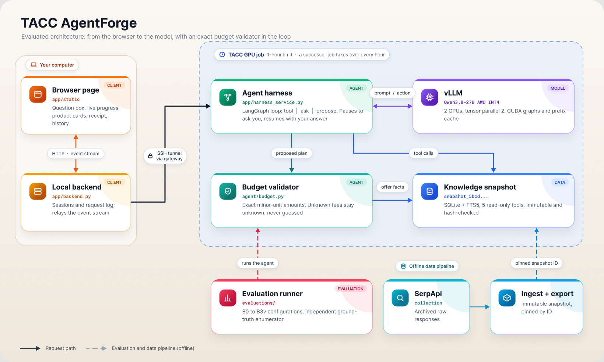

<h1 align="center"> TACC AgentForge</h1>

<p align="center"><strong>A TACC-hosted shopping agent that uses a quantized 27B model to recommend products with source links and budget-checked totals.</strong></p>

<p align="center">
  <a href="#getting-started-instructions">Getting Started</a> ·
  <a href="#detailed-instructions">Detailed Instructions</a> ·
  <a href="#main-results">Main Results</a> ·
  <a href="#project-status-what-is-and-is-not-done">Status</a> ·
  <a href="#known-limitations-and-expected-variation">Limitations</a>
</p>

TACC AgentForge is the course project for **Advanced AI Computing and Systems (CSIT6000V)**. A user describes what they need and how much they can spend. The agent searches a source-linked product catalog, compares offers, checks the plan against the budget with exact decimal arithmetic, and explains its recommendation with citations. The model is the course-provided **Qwen3.8-27B AWQ INT4** checkpoint, served by vLLM on two GPUs on the TACC cluster.

<p align="center">
  
</p>

*Recorded on TACC with the real model: asked what to buy for a trip to Bali with a $200 budget, the agent asks what is needed, then recommends a backpack, earbuds and a power bank for **$87.34 before tax** and shows the **$112.66** left in the budget. Idle waits are shortened.*

<p align="center"></p>

*The evaluated deployment. Post-training is a pilot; see [Project status](#project-status-what-is-and-is-not-done).*

In the evaluated deployment, the browser talks to a local Python backend (`app/`), which reaches TACC over SSH. One two-GPU TACC job runs vLLM and the agent harness (`agent/`) side by side. The agent queries a pinned SQLite/FTS5 catalog snapshot (`knowledge/`) and only returns plans approved by the budget validator (`agent/budget.py`).

## What this artifact contains

| Directory | Contents |
|---|---|
| `agent/` | LangGraph agent loop, tools, exact budget validator, checkpoints ([internals](agent/ARCHITECTURE.md)) |
| `app/` | Browser page, local backend, harness HTTP service, offline demo and self-test |
| `knowledge/` | SerpApi collection, SQLite/FTS5 snapshots, retrieval tools ([guide](knowledge/README.md)) |
| `assets/knowledge/pilot-snapshot.zip` | The frozen catalog snapshot used by every evaluation (`snapshot_5bcd00723fb0b7589cbe50c8`) |
| `evaluations/` | 42 test cases, independent ground-truth enumerator, scorer, baseline runner, freeze manifest, **raw results** |
| `evaluations/v1/`, `evaluations/bench.py`, `budget/` | Additional v1 benchmark on synthetic fixtures (not part of C1–C7): 50 cases, independent oracle, six configurations, its own business-side validator ([runbook](evaluations/v1/README.md)) |
| `inference/` | Model client, serving-experiment runner and report generator, **raw serving results** |
| `deploy/tacc/` | TACC job definitions: vLLM service with hourly handover, evaluation job, serving experiments, private vLLM build, SFT jobs |
| `deploy/benchmark/` | Container and helpers for the public ShoppingBench track of the v1 benchmark |
| `training/` | LoRA SFT pilot on the INT4 checkpoint: data pipeline, trainer, raw results ([report](training/README.md)) |
| `scripts/check_artifact.py` | **One command that runs every stage below that needs no GPU** and prints `SUCCESS`/`FAILED` per stage |
| `scripts/reproduce_results.py` | One command that recomputes the reported numbers from the committed raw data |
| `docs/experiments/` | Experiment reports (baseline, private vLLM, LoRA feasibility, data collection) |
| `tests/`, `agent/tests/` | About 700 automated tests that run offline |

No model weights, adapters or credentials are in the repository. The base model is the course-provided checkpoint on TACC. The trained LoRA adapter (about 218 MB) stays on the cluster.

## Main Results

All numbers come from runs on TACC. The raw data is committed, and `scripts/reproduce_results.py` recomputes each one (see [Step 1](#step-1-recompute-every-reported-number-under-1-minute)). The *Project report* column gives the section, table or figure of the group's project report (submitted as a PDF; its source and build script are in [`report/`](report/), and its appendix reproduces this README) that reports each result.

| ID | Result | Project report | Evidence in this repo |
|---|---|---|---|
| **C1** | On 32 held-out cases × 3 repeats, the full agent (B3v: multi-step tools + budget validator) succeeds in **42/96** attempts. The single-call baselines B0/B1/B2 do better overall: 54/96, 57/96, 57/96. | §4.1, Table 3 | [baseline report §4](docs/experiments/baseline.md), `evaluations/results/frozen-heldout/` |
| **C2** | The budget validator helps: B3 → B3v paired difference **+0.10 (95% CI +0.02 to +0.20)**. No configuration delivered an over-budget plan (BVR 0 in all five). | §4.1, Table 3 | baseline report §4 |
| **C3** | The multi-step agent wins on cases that need searching (plan cases: B3v 33/60 vs. at most 21/60 for single calls). It loses overall because **48/96 runs stop at the 8-call model limit**, including 22/24 runs on cases with no feasible plan (issue #21). | §4.1, Fig. 3, Table 4 | baseline report §4, §6–7 |
| **C4** | Serving, one flag changed at a time: CUDA graphs give **+202% output throughput** over eager mode (67.4 → 203.9 tok/s, distinct prompts, concurrency 8). In eager mode, prefix caching cuts TTFT p50 by 71% on shared-prefix prompts. FlashInfer attention and the FP8 KV cache fail on this setup. | §4.3, Table 6, Fig. 4 | [inference/RESULTS.md](inference/RESULTS.md), `inference/results/` |
| **C5** | MTP speculative decoding crashed during CUDA-graph capture on this hybrid model. A one-line vLLM patch fixes it; with CUDA graphs, MTP k=3 then gives **+42% single-request throughput** (57.7 → 81.8 tok/s), but little or no gain at 4 concurrent requests (−2% to +9%). Each cell is a single measurement. | §4.4, Table 7 | [private-vLLM report, E5c](docs/experiments/2026-11-06-private-vllm-feasibility/PLAN.md), [patch](deploy/tacc/private-vllm/patches/E5c-warmup-spec-decode-metadata.patch), `inference/results/private-spec-mtp-28403/` |
| **C6** | SFT pipeline pilot: a LoRA adapter trained on the INT4 checkpoint and served by vLLM picks the correct catalog category on the first step in **8/8** prompts, vs. 2/8 for the base model. **This is a pipeline check, not a quality result**: 10 prompts, dev cases only (partly seen in training), first action only. | §4.5, Table 8 | [training/README.md](training/README.md) §3–5, `training/results/` |
| **C7** | Post-freeze fix for issue #21 (PR #29, merged into `main` after the freeze): in targeted replays with the real model (3 requests × 3 repeats), dev-07 (no feasible plan) ends in 3 model calls with `no_feasible_plan` instead of 8 calls at the limit, and dev-04 still completes with a verified plan in 5 calls. **The held-out split was not rerun**, so there is no new overall TSR. | §4.2, Table 5 | [finalization report](docs/experiments/2026-11-17-agent-finalization/MAIN_REPLAY.md), `docs/experiments/2026-11-17-agent-finalization/main-real-replay.json` |

**v1 benchmark (additional, not part of C1–C3):** a synthetic-fixture track with 10 dev + 32 heldout cases, its own independent oracle and six configurations. Its runbook is [evaluations/v1/README.md](evaluations/v1/README.md). The reported dev numbers use 10 cases and one repeat; they are not a formal heldout result and do not replace the frozen baseline above.

---

# Getting Started Instructions

Expected time: about **10 minutes**, with no GPU and no TACC account. This part shows that the artifact installs, its tests pass, and the full request path works end to end: page → backend → harness → knowledge base → budget validator. A scripted stand-in replaces the model.

After [Setup](#setup), one command runs every check of this section and Step 1 of the Detailed Instructions, and prints `SUCCESS` or `FAILED` for each stage ([Example 0](#example-0-one-command-check-about-4-minutes)). Examples 1–2 run the same checks one at a time.

## Prerequisites

- macOS or Linux. This README was verified on macOS with Python 3.12. The team also developed on Windows; there, set `PYTHONUTF8=1` (issue #5) and use `.venv\Scripts\python.exe`.
- Python **3.12**
- [`uv`](https://docs.astral.sh/uv/) (recommended) or `pip`
- `git` and `curl`
- About 150 MB of disk

Only needed for the optional real-model run and for rerunning experiments: a CSIT6000V TACC account with the `tcloud` SDK configured ([setup](deploy/tacc/README.md)).

## Setup

```bash
git clone https://github.com/atlasmarkz/tacc-agentforge.git
cd tacc-agentforge
uv venv --python 3.12 .venv
uv pip install --python .venv/bin/python -r agent/requirements.lock pytest python-dotenv
# without uv: python3.12 -m venv .venv && .venv/bin/pip install -r agent/requirements.lock pytest python-dotenv

# Install the pinned catalog snapshot (written to ../tacc-agentforge-data/, next to the clone)
.venv/bin/python -m knowledge bootstrap
.venv/bin/python -m knowledge doctor
```

**Expected:** `doctor` prints a JSON report that starts with `"ready": true` and ends with
`"valid": true, "snapshot_id": "snapshot_5bcd00723fb0b7589cbe50c8", "errors": []`.

## Example 0: one-command check (about 4 minutes)

```bash
.venv/bin/python scripts/check_artifact.py
```

**Expected:** seven stages, each ending in `SUCCESS`, then the final line `ALL 7 STAGES SUCCEEDED` (exit code 0):

```text
[1/7] environment          SUCCESS (0 s): Python 3.12.x, dependencies import
[2/7] catalog snapshot     SUCCESS (1 s): snapshot_5bcd00723fb0b7589cbe50c8 installed and verified (FTS5: True)
[3/7] automated tests      SUCCESS (85 s): 697 passed, 1 skipped, 14 subtests passed in ...
[4/7] harness self-test    SUCCESS (1 s): SELFTEST OK (10/10 checks true)
[5/7] end-to-end request   SUCCESS (3 s): verified plan offer_640a303bc366430cfd53139e: total 16.87 USD, 83.13 left; without a budget the run asks for one
[6/7] main results         SUCCESS (1 s): ALL MATCH (6 comparisons: C1-C7 recomputed from the committed raw data)
[7/7] v1 benchmark         SUCCESS (1 s): fixture data verified; preflight READY (a model endpoint is only needed for new runs)

ALL 7 STAGES SUCCEEDED
```

A failed stage prints the reason and the end of the failing command's output, and the other stages still run. For example, `[1/7] environment FAILED: missing packages [...]` means the Setup install command was not run with this interpreter. Add `--skip-tests` to leave out stage 3.

## Example 1: automated tests (about 1.5 minutes)

```bash
.venv/bin/python -m pytest tests agent/tests -q
```

**Expected:** `697 passed, 1 skipped` and no failures. The single skip is expected: one `test_sft.py` test because PyTorch is not installed (training runs on TACC). Without `python-dotenv` (part of the Setup command), six more tests are skipped.

## Example 2: end-to-end request without a GPU (about 1 minute)

First, the scripted self-test. It starts the harness service over real HTTP and checks budget clarification, resume, verified plan, streamed explanation, revision, source lookup and token checks:

```bash
.venv/bin/python -m app.harness_service --selftest
```

**Expected:** a JSON block with every check `true`, then `SELFTEST OK`.

Next, the same path that the browser uses. Start the demo harness (scripted model, real catalog snapshot, real budget validator) and the backend in two terminals:

```bash
.venv/bin/python -m app.harness_service --demo --port 8101 --token demo
.venv/bin/python -m app.backend --harness-url http://127.0.0.1:8101 --token demo
```

Open http://127.0.0.1:8765 and ask: *wireless earbuds for commuting, under 100 USD*. Or send the request from a third terminal:

```bash
curl -sN --noproxy '*' http://127.0.0.1:8765/api/ask -H 'Content-Type: application/json' -d '{
  "session_id": "s1234567890abcdef",
  "message": "wireless earbuds for commuting, under 100 USD",
  "constraints": {"currency": "USD", "purchase_cap": "100", "budget_basis": "pre_tax"}}'
```

**Expected:** a stream of server-sent events (`run_started`, `tool_started`/`tool_finished`, `propose_plan`, `validation_finished`, `explain_delta`, …) ending in `run_completed` with

```text
"status": "completed" ... "verified_plan": {"snapshot_id": "snapshot_5bcd00723fb0b7589cbe50c8",
  "items": [{"offer_id": "offer_640a303bc366430cfd53139e", "quantity": 1, ...}],
  "currency": "USD", "total_cost": "16.87", "remaining_funds": "83.13",
  "cost_breakdown": {"items": "9.88", "shipping": "6.99"}}
```

`--noproxy '*'` keeps an `HTTP_PROXY` setting from sending the local request elsewhere. Stage 5 of Example 0 sends the same request and checks this result automatically.

Leave out `purchase_cap` and the run instead stops with `"status": "waiting_user"` and a question asking for the budget. In the page, answering it resumes the run. The scripted model follows a fixed script, so this example tests the system around the model, not the model's decisions.

## Example 3 (optional): the real model on TACC

With `tcloud` configured, start vLLM and the harness in one two-GPU job:

```bash
bash deploy/tacc/service/qwen-service/stage.sh serve --harness
(cd deploy/tacc/service/qwen-service && tcloud submit)
```

After 5–8.5 minutes, once the job has published `harness-url.txt` on the cluster, run `.venv/bin/python -m app.backend` locally and open http://127.0.0.1:8765. The backend reaches the cluster over SSH, so first set the SSH host and key as described in [app/README.md](app/README.md). Stopping the service is covered in the [runbook](deploy/tacc/service/RUNBOOK.md) §6. In the evaluation, a full-system request took 19 s at the median and 37 s at p95, measured on the cluster (baseline report §5).

---

# Detailed Instructions

The results can be checked at two levels:

1. **Recompute every reported number from the committed raw data** (Step 1, under 1 minute, no GPU). Each recorded model output is rescored independently against the frozen snapshot, and each report is regenerated. This is the reproduction of C1–C7, and stage 6 of [Example 0](#example-0-one-command-check-about-4-minutes) runs it.
2. **Optional: rerun experiments on TACC** to produce new raw data (Steps 2–5). This needs a TACC account and GPU time. The quickest real-model check is Step 2a (under an hour); the others take one to several hours each. On 2026-11-19 we followed Steps 2a and 4 from a fresh clone; the results are given in those steps.

## Test cases, data and configurations

| Item | Location |
|---|---|
| Test cases | `evaluations/cases.jsonl`: 42 cases (10 dev, 32 held-out), 4 categories (earbuds, chargers, keyboards, backpacks), English and Chinese. Per split, plan expected / no feasible plan / must ask for budget = 6/2/2 (dev) and 20/8/4 (held-out). |
| Ground truth | Computed, not hand-written: `evaluations/catalog.py` reads the snapshot's SQLite file directly, independently of the agent's tools and validator. |
| Catalog data | `assets/knowledge/pilot-snapshot.zip`, snapshot `snapshot_5bcd00723fb0b7589cbe50c8` (251 offers) |
| Configurations | B0: one model call with the top 10 in-budget candidates. B1/B2: B0 plus the top 5 keyword/filtered evidence records. B3: multi-step agent with real tools; the validator is replaced by a recorder (ablation). **B3v: the full system**, B3 plus the real budget validator. All use temperature 0, thinking off and JSON output. |
| Agent settings | `configs/agent.yaml`, profile `tacc-fast`: 8 model calls, 36,000-character context, 512 output tokens |
| vLLM settings | `deploy/tacc/service/qwen-service/service.json`: TP=2, max length 16384, prefix caching, CUDA graphs |
| Serving experiment matrix | `configs/experiments.json`: groups `serving27b` (eager baseline), `graphs` (CUDA graphs), `spec-mtp` (C5) |
| Freeze manifest | `evaluations/freeze.json`: SHA-256 of every evaluated file plus the resolved settings (digest `03b0cdea`) |
| Metrics | TSR (task success rate), BVR (budget violation rate), constraint violations, unverifiable claims, made-up IDs; per-case bootstrap 95% CIs. Definitions: [docs/evaluation-metrics.md](docs/evaluation-metrics.md); scoring rules: [evaluations/README.md](evaluations/README.md) §5. |

## Step 1: recompute every reported number (under 1 minute)

```bash
.venv/bin/python scripts/reproduce_results.py
```

The script does six checks:

- **C1–C3:** rescores all 480 held-out and 180 dev attempts in `evaluations/results/frozen-{heldout,dev}/records.jsonl` against the frozen snapshot.
- **C4:** regenerates `inference/RESULTS.md` from `inference/results/`.
- **C5:** recomputes the MTP throughput table from the raw benchmark output.
- **C6:** recounts the SFT first-step check from the raw model outputs.
- **C7:** tallies model calls and end states of the 9 post-freeze replays.

Each result is compared with the committed copy and marked `MATCH` or `DIFFERS`. The script must end with `ALL MATCH`; stage 6 of `scripts/check_artifact.py` runs it and checks this.

**Expected output** (abridged):

```text
== frozen-heldout: 32 cases x 3 repeats (480 attempts)
config      TSR  per-case mean (95% CI)      BVR  plans
B0        54/96  0.56 (0.38-0.72)           0/25  25
B1        57/96  0.59 (0.44-0.75)           0/27  27
B2        57/96  0.59 (0.44-0.75)           0/26  26
B3        32/96  0.33 (0.19-0.50)           0/42  42
B3v       42/96  0.44 (0.28-0.60)           0/36  36
  paired B0 -> B1: +0.03 (95% CI +0.00 to +0.09)
  paired B1 -> B2: +0.00 (95% CI +0.00 to +0.00)
  paired B2 -> B3: -0.26 (95% CI -0.47 to -0.05)
  paired B3 -> B3v: +0.10 (95% CI +0.02 to +0.20)
  by expected outcome (plan / no feasible plan / ask for budget), runs stopped at the model-call limit:
  B0     18/60 /  24/24 /  12/12   call limit: 0
  ...
  B3v    33/60 /   0/24 /   9/12   call limit: 48
MATCH: frozen-heldout vs evaluations/results/frozen-heldout/report.json
...
== MTP speculative decoding with CUDA graphs (patched vLLM), output tok/s
  variant         distinct-c1  shared_prefix-c1       distinct-c4  shared_prefix-c4
  baseline               57.7              37.6             139.5              63.9
  mtp-k1                 73.5              44.2             129.0              67.0
  mtp-k3                 81.8              47.9             136.8              69.8
MATCH: ...
== SFT pilot, first action on 10 dev prompts (base model vs LoRA adapter)
  correct catalog category: base 2/8, adapter 8/8
  asks for the missing budget first: base 1/2, adapter 0/2
MATCH: ...
== Post-freeze issue #21 fix: real-model replays on main (3 repeats each)
  issue-21-charger  1 calls, waiting_user | 1 calls, waiting_user | 1 calls, waiting_user
  dev-07            3 calls, no_feasible_plan | 3 calls, no_feasible_plan | 3 calls, no_feasible_plan
  dev-04            5 calls, completed | 5 calls, completed | 5 calls, completed
MATCH: ...
ALL MATCH
```

The rescored `report.json` files (path printed at the end) also contain breakdowns by category, failure reason, model calls and latency (baseline report §4–7). Complete model inputs and outputs for the failure traces are in `evaluations/results/frozen-trace-dev/traces.jsonl`.

To rescore a single results folder by hand:

```bash
unzip -oq assets/knowledge/pilot-snapshot.zip -d /tmp/agentforge-snapshot
.venv/bin/python -m evaluations.run --rescore <folder with records.jsonl> \
  --snapshot-db /tmp/agentforge-snapshot/snapshot_5bcd00723fb0b7589cbe50c8/catalog.sqlite
```

## Step 2: rerun the agent evaluation on TACC (C1–C3)

**Use the frozen commit.** The runner refuses the held-out split unless the files match `evaluations/freeze.json`. Later commits on `main` changed the agent, so check out the evaluated system first:

```bash
git checkout cc6059d
# Keep the portable Miniconda path from main so any TACC account can install harness deps (not part of freeze.json)
git checkout main -- deploy/tacc/service/agent-e2e/job.sh deploy/tacc/service/app-service/harness-lib.sh
.venv/bin/python -m evaluations.freeze check      # expected: "matches the freeze"
```

**Start the model service** (2 GPUs). For anything longer than one hour, enable handover so that a successor job takes over before the 1-hour limit ([runbook](deploy/tacc/service/RUNBOOK.md) §2):

```bash
# on the cluster, only for runs longer than 1 hour: allow up to 3 successor jobs
echo '{"remaining": 3}' > $TACC_USERDIR/tacc-agentforge-service/service-chain.json
# locally: hand over 15 minutes before the limit
echo '--handover-lead-s 900' > deploy/tacc/service/qwen-service/args.txt
bash deploy/tacc/service/qwen-service/stage.sh serve
(cd deploy/tacc/service/qwen-service && tcloud submit)
```

### Step 2a: short rerun (under 1 hour)

This checks the direction of C1 and C3 on fresh model outputs: the dev split, B0 vs. B3v, one repeat, 20 attempts.

```bash
cd deploy/tacc/service/agent-e2e
echo eval_baseline.py > script.txt
echo '--split dev --configs B0,B3v --repeats 1' > args.txt
bash stage.sh && tcloud submit
```

The runner waits until the service is ready (5–8.5 minutes) and then needs about 5 minutes. Its Slurm log (`$TACC_USERDIR/slurm_log/agent-e2e-<job id>.log`) ends with one summary line per configuration, and the results are in `$TACC_USERDIR/tacc-agentforge-service/eval-<job id>/`. **Expected:** B0 near 7/10 and B3v near 4–6/10, with some B3v runs stopping at the model-call limit, and BVR 0 for both. With 10 attempts per configuration, a difference of one or two cases is within noise; frozen dev over 3 repeats gave B0 21/30 and B3v 14/30 with 13 call-limit stops.

Our check from a fresh clone on 2026-11-19 (service job 29905, runner 29897) ended with:

```text
B0: TSR 7/10 by case {'mean': 0.7, 'ci95': [0.4, 1.0], 'cases': 10} BVR {'n': 0, 'm': 4, 'rate': 0.0} reasons {'ok': 7, 'unnecessary_clarification': 2, 'violates_requirement': 1}
B3v: TSR 6/10 by case {'mean': 0.6, 'ci95': [0.3, 0.9], 'cases': 10} BVR {'n': 0, 'm': 5, 'rate': 0.0} reasons {'ok': 6, 'error:model_call_limit': 3, 'unverifiable_claim': 1}
```

### Step 2b: full held-out rerun

```bash
# use an absolute path under your USERDIR, so that resubmitting the job never touches the records
echo '--split heldout --unseal-heldout --configs B0,B1,B2,B3,B3v --repeats 3 --out /mnt/home/<TACC username>/USERDIR/heldout-rerun --resume' > args.txt
bash stage.sh && tcloud submit
```

- **Resources:** both of the account's job slots (the service and the runner) and 480 attempts. Attempt durations add up to about 1.4 hours. Our run spanned about 2.5 hours across several 1-hour jobs, including a one-hour gap when no node was free (services 28999/29011/29016; runner 29006/29014/29015/29017).
- **When a runner job reaches its time limit, submit it again with the same arguments** (`bash stage.sh && tcloud submit` with the same `args.txt`). `--resume` skips recorded attempts. Attempts lost to service gaps are retried automatically and logged to `infra.jsonl`; they do not count as system failures.
- **Score:** the runner writes `records.jsonl`, `scores.jsonl` and `report.json`. Compare `report.json` → `summary` with Step 1. Afterwards, empty `deploy/tacc/service/qwen-service/args.txt` so the next service run does not inherit it.

More detail: [evaluations/README.md](evaluations/README.md) §7–8.

## Step 3: rerun the serving experiments on TACC (C4, C5)

**C4** uses the public course runtime:

```bash
cd deploy/tacc/vllm-experiments
bash stage.sh serving27b 2 && tcloud submit      # eager baseline + one-flag variants
bash stage.sh graphs 2 && tcloud submit          # CUDA-graph baseline + variants
# copy each job's result folder into inference/results/, then:
.venv/bin/python -m inference.report inference/results/serving27b-* inference/results/graphs-* --out inference/RESULTS.md
```

The two groups share the `vllm-experiments` job directory: **submit the second one only after the first job shows `RUNNING` in `squeue`**, because a job reads its group when it starts. Each variant restarts vLLM, which takes 3.5–9 minutes, so one group fills most of a 1-hour job. If a job ends early, run the missing variants with `stage.sh <group> 2 <variant> ...`. Workload: 8 prompts × 2 repeats per stage at concurrency 1/4/8, plus `vllm bench serve` (512 input / 128 output tokens, 32 prompts).

**C5** needs the course's private-vLLM source, `vllm-v0.26.0.tar.gz`. It is not in this repository, but every course account can copy it from the cluster (SHA-256 `c1ded7e5…`):

```bash
scp -P 30041 <TACC username>@gw.turing.ust.hk:/mnt/home/public/course-envs/CSIT6000V/project-private-vllm/student-release/vllm-v0.26.0.tar.gz deploy/tacc/private-vllm/
```

Then follow [deploy/tacc/private-vllm/README.md](deploy/tacc/private-vllm/README.md) §1–3:

1. Run `prepare-source.sh`.
2. Apply the one-line change in [the E5c patch](deploy/tacc/private-vllm/patches/E5c-warmup-spec-decode-metadata.patch) to `vllm-src/vllm/v1/worker/gpu_model_runner.py` **by hand**. The patch file has no line numbers, so `patch` cannot apply it.
3. Run `submit-build.sh`.
4. Run the benchmark:
   ```bash
   bash deploy/tacc/private-vllm/qwen-private-experiments/stage.sh spec-mtp
   (cd deploy/tacc/private-vllm/qwen-private-experiments && tcloud submit)
   ```

## Step 4: rerun the post-freeze replays on TACC (C7)

The replay command is in [MAIN_REPLAY.md](docs/experiments/2026-11-17-agent-finalization/MAIN_REPLAY.md) (`scripts/replay_agent_finalization.py`; use `.venv/bin/python` where it says `agent/.venv/bin/python`). It needs a running model service (Step 2) reachable through `--base-url` or `--address-file`, and runs dev-07, dev-04 and the original issue #21 charger request 3 times each on current `main`. The documented run used vLLM in eager mode, so compare call counts and end states, not latency. To reach the service from your machine, forward a local port to the address in `$TACC_USERDIR/tacc-agentforge-service/service-url.txt`, for example `ssh -N -L 18084:<node IP>:8000 <TACC username>@gw.turing.ust.hk -p 30041`, and pass `--base-url http://127.0.0.1:18084/v1`.

Our check from a fresh clone on 2026-11-19 (service job 29905, CUDA graphs) gave the same call counts and end states in all 9 runs: issue-21-charger 1 call, `waiting_user`; dev-07 3 calls, `no_feasible_plan`; dev-04 5 calls, `completed`.

## Step 5: rerun the SFT pilot on TACC (C6)

Follow [training/README.md](training/README.md) §6. The data step runs offline:

```bash
.venv/bin/python -m training.prepare_data --cases evaluations/cases.jsonl \
  --traces evaluations/results/traces-dev-28620/traces.jsonl --out data/sft/train.jsonl
```

It prints 69 examples from 6 cases, which matches training/README §2. Training (`deploy/tacc/train-sft/`) and serving (`deploy/tacc/train-sft-serve/`) each need a 2-GPU job. Use `tcloud submit` in place of the Windows helper shown there. **Note:** the regenerated file's SHA-256 (`880183e9…`) differs from the `train_sha256` recorded for job 28670 (`5a5475ad…`, in `training/results/sft-pilot-28670/training_meta.json`). The example counts match, but the exact training input of that job cannot be verified byte for byte from this repository.

## Additional: v1 benchmark (not part of C1–C7)

The v1 benchmark is a separate, synthetic-fixture track ([runbook](evaluations/v1/README.md), [design](docs/benchmark-design.md)). Only dev runs exist (10 cases, one or three repeats); the held-out split has not been run, so it supports no claim above. Its fixture data (revision 2) and preflight are checked offline by stage 7 of Example 0:

```bash
.venv/bin/python -m evaluations.v1.suite verify      # expected: the manifest with "revision": 2
.venv/bin/python -m evaluations.bench check          # expected: RESULT: READY
.venv/bin/python -m evaluations.bench report --input evaluations/results/v1-dev-29437   # rewrites REPORT.md; identical to the committed one
```

A new run needs a model endpoint (`BENCHMARK_BASE_URL` or `BENCHMARK_ADDRESS_FILE`, for example the service of Step 2); see the runbook §2–3.

---

# Project status: what is and is not done

| Part | Status |
|---|---|
| Model serving on TACC (vLLM, 2 GPUs, hourly handover between jobs) | Done; measured in [the runbook](deploy/tacc/service/RUNBOOK.md) |
| Knowledge base (SerpApi collection, versioned snapshots, retrieval tools) | Done; 4 categories in the evaluated snapshot |
| Agent loop, tools, exact budget validator, pause and resume | Done |
| Browser page and backend | Done (in-cluster deployment); a separate public cloud deployment is on the [`feat/cloud-agent-service`](https://github.com/atlasmarkz/tacc-agentforge/tree/feat/cloud-agent-service) branch and is not part of the evaluation |
| Evaluation: cases, independent ground truth, frozen baselines | Done (C1–C3) |
| Serving experiments, private vLLM build and MTP fix | Done (C4–C5); n-gram speculation was not retested after the fix |
| SFT | Pilot only (C6); no end-to-end evaluation of the adapter |
| Fifth, unseen category; human ratings of explanations; retrieval Recall@5/MRR@5 | Not done. The 602-row relevance pool in `evaluations/relevance_pool.jsonl` is unlabeled. |
| v1 benchmark (synthetic fixtures, six configurations, ShoppingBench track) | Dev runs and tooling done; held-out split not run; its fifth category (`desk_lamps`) is not released. Not used for C1–C7. |
| Fix for the model-call limit (issue #21) | Fixed on `main` after the freeze (PR #29, C7) and checked in 9 targeted real-model replays. The frozen system (`cc6059d`) still has this failure mode, and the held-out split was not rerun with the fix. |

## Known limitations and expected variation

- **Step 1 is exact.** Rescoring and report generation are deterministic (the bootstrap is seeded), so the script must print `ALL MATCH`.
- **A TACC rerun of the agent will not give identical counts.** All configurations use temperature 0, but vLLM batching and prefix-cache state are not bit-deterministic, so individual multi-step (B3/B3v) attempts can change. We expect, but have not measured across reruns, that held-out TSRs stay within the reported per-case 95% intervals; for example, the interval for B3v (42/96) is 0.28–0.60.
- **Latency and throughput depend on the node.** GPU model and co-located jobs vary across TACC nodes; the logs suggest RTX 3090-class GPUs with about 23.7 GiB. Compare relative changes within one job, not absolute numbers across jobs. The serving report marks changes under 3% as "~same". C5 has one measurement per cell.
- **TACC node quirks are handled in the job scripts.** All GPU jobs exclude 10-0-1-10 and 10-0-1-11, whose GPUs are held by processes outside Slurm. On the other `-11` nodes Slurm assigns GPU IDs 2,3 while the job sees 0,1; the job scripts renumber them (log line `CUDA_VISIBLE_DEVICES 2 3 is outside the 2 visible GPUs; using 0,1`). Before this fix, which the 2026-11-19 check added to the serving-experiment, SFT-serving and private-vLLM jobs, every variant there failed with `NVMLError_InvalidArgument`. If a job log says `GPUs already in use by processes outside this job`, another node has the same problem: submit again, and Slurm usually picks another node.
- **The model-call limit dominates the frozen system's failures** (C3, issue #21). There, the agent does not know how many calls it has left, and paginated searches that include unknown-price items keep it searching. The fix on `main` (C7) is supported only by 9 targeted replays, not by a held-out rerun.
- **Correctness is relative to the frozen snapshot**, not to the real world. All 251 offers have unknown tax, so budgets are compared before tax. Known data errors in the snapshot carry over into the ground truth ([evaluations/README.md](evaluations/README.md) §4).
- **The validator checks money, not requirements.** It approved three B3v plans even though a required attribute was unknown (baseline report §6).
- **TACC availability.** The service needs a free 2-GPU node, and a queued successor job leaves a gap of minutes or more. The runner waits and retries instead of failing.
- **One flaky test was fixed after the frozen commit.** On `main` before this fix, cancelling a streaming model call could hang until its 20 s timeout: the cancelling thread closed the socket, and its file descriptor could be reused while the reading thread was about to call `recv()`. `tests/test_client.py::test_stream_cancel_mid_generation` failed in about 1 of 12 runs under load because of it. Cancellation now only shuts the socket down (`inference/client.py`); 32 parallel stress runs passed. The frozen commit `cc6059d` still has the race, which affects cancellation only, not the scored results.
- **Documentation language.** Several sub-guides (`evaluations/README.md`, `docs/experiments/baseline.md`, `training/README.md`, the runbook) are written in Chinese. This README contains everything needed to run and reproduce the results.

## Further reading

- [Baseline evaluation report](docs/experiments/baseline.md) · [Metric definitions](docs/evaluation-metrics.md) · [Evaluation guide](evaluations/README.md)
- [Serving experiment results](inference/RESULTS.md) · [Private vLLM experiments](docs/experiments/2026-11-06-private-vllm-feasibility/PLAN.md) · [Model service runbook](deploy/tacc/service/RUNBOOK.md)
- [Agent internals](agent/ARCHITECTURE.md) · [Knowledge base](knowledge/README.md) · [Application](app/README.md)
- [SFT pilot](training/README.md) · [LoRA feasibility on the INT4 model](docs/experiments/2026-10-28-27b-lora-feasibility/README.md) · [SerpApi data collection](docs/experiments/2026-10-28-serpapi-collection/README.md)
- [Project proposal](output/pdf/shopping-budget-advisor-proposal.pdf) · [Development plan](tasks/plan.md)

## License

No license has been selected. All rights are reserved by the repository owner.
