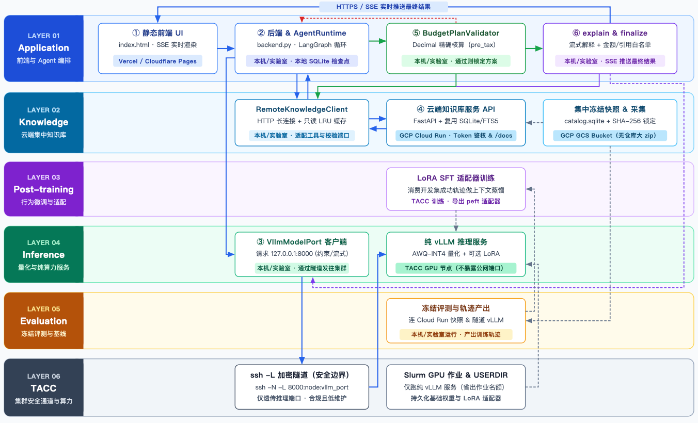

<h1 align="center"> TACC AgentForge</h1>

<p align="center"><strong>A TACC-hosted shopping agent that uses a quantized 27B model to recommend products with source links and budget-checked totals.</strong></p>

<p align="center">
  <a href="#live-demo">Live Demo</a> ·
  <a href="#architecture">Architecture</a> ·
  <a href="#quick-start">Quick Start</a> ·
  <a href="#evaluation">Evaluation</a>
</p>

The project combines two-GPU model serving with a browser-based shopping advisor for the **Advanced AI Computing and Systems** course. The advisor can ask for missing details, resume after the user answers, and revise a recommendation when the budget changes.

## Live Demo

<p align="center">
  
</p>

The demo runs on TACC. The agent recommends earbuds costing **$22.99 before tax** and shows the source alongside the **$77.01** left in the budget. Idle waits are shortened in the recording.

## Architecture



*Target architecture, including cloud-hosted knowledge services and LoRA training.*

In the deployment used for the demo, the browser receives live progress from a local Python backend, which connects to TACC over SSH. A single two-GPU job runs the agent and vLLM with **Qwen3.8-27B AWQ INT4**. The agent searches a pinned SQLite catalog and verifies offer costs and the remaining budget before returning a recommendation. The live query path uses the existing catalog snapshot.

[Deployment runbook](deploy/tacc/service/RUNBOOK.md) · [Knowledge base](knowledge/README.md) · [Agent internals](agent/ARCHITECTURE.md)

## Quick Start

From the repository root on macOS or Linux, with the TACC SDK configured and `tcloud` on your PATH:

```bash
bash deploy/tacc/service/qwen-service/stage.sh serve --harness
(cd deploy/tacc/service/qwen-service && tcloud submit)
```

Once the service is ready, run `python -m app.backend` and open [the local app](http://127.0.0.1:8765). Try asking for wireless earbuds for your commute with a **$100** budget. The [application guide](app/README.md#运行) covers SSH settings and the local demo mode.

## Evaluation

The full agent scored **42 successes in 96 attempts** on the frozen four-category held-out baseline. That result is tied to the recorded code and catalog snapshot. The [baseline report](docs/experiments/baseline.md) records the scoring rules, latency, and failure traces.

The v1 benchmark implementation and runbook are in [evaluations/README.md](evaluations/README.md); the design rationale is in [docs/benchmark-design.md](docs/benchmark-design.md).
