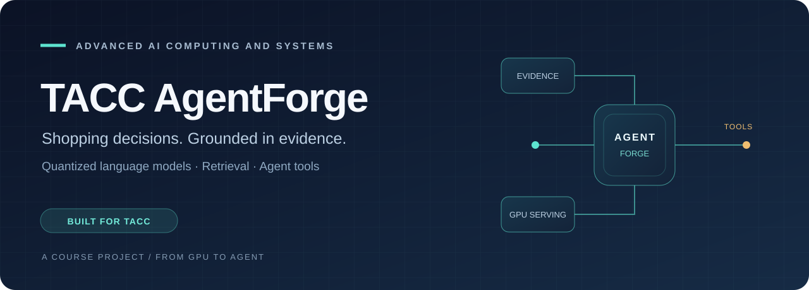

# TACC AgentForge — cloud deployment



TACC AgentForge is a course project for **Advanced AI Computing and Systems**: a shopping and budget advisor built on a large language model served on the TACC platform. A user describes what they need and how much they can spend. The agent searches a source-linked product knowledge base, compares offers, checks the plan against the budget exactly, and explains its recommendation with citations.

**This branch (`feat/cloud-agent-service`) is the cloud deployment of the project** ([issue #25](https://github.com/atlasmarkz/tacc-agentforge/issues/25)). The page is public and the agent runs around the clock on a free cloud VM; TACC only serves the model. It is maintained separately and is not merged into `main`. `main` keeps the in-cluster deployment (agent and model in the same TACC job, page on the developer's machine), and core changes from `main` are merged into this branch.

**Live page:** https://tacc-agentforge.pages.dev (available while the service is switched on; see [Operating the service](#operating-the-service)).

## Architecture

```text
Browser ──HTTPS──▶ Cloudflare Pages: tacc-agentforge.pages.dev   (app/static/index.html)
                    │ Pages Function /api/*: same-origin proxy, shared secret + visitor IP
                    ▼
             Tailscale Funnel: https://<vm>.<tailnet>.ts.net      (outbound only, no open ports)
                    ▼
  GCE VM (e2-micro, free tier) ───────────────────────────────────────────────────────────
  │ agentforge-backend   app/backend.py          checks the proxy secret, run ownership, rate limits
  │ agentforge-harness   app/harness_service.py  AgentRuntime, knowledge snapshot, budget validator,
  │                                              SQLite checkpoints on local disk
  │ agentforge-tunnel    app/model_tunnel.py     follows the vLLM address, keeps ssh -L open
  │ agentforge-keeper    app/service_keeper.py   submits the vLLM job, keeps the handover chain going
  ─────────────────────────────────┬──────────────────────────────────────────────────────
                                   │ SSH via the TACC gateway
                                   ▼
  TACC: vLLM serving Qwen3.8-27B-AWQ-INT4 on 2 GPUs; a successor job takes over every hour

  GCS: immutable knowledge snapshots, gs://<bucket>/snapshots/<snapshot_id>.zip
```

The whole setup costs nothing: the VM and the bucket stay inside the GCP Always Free tier, Cloudflare Pages and Tailscale's personal plan are free, and no domain is needed. Step-by-step setup: [deploy/gcp/README.md](deploy/gcp/README.md).

## Features

**For the user (web page)**

- Ask in English or Chinese, e.g. "wireless earbuds for commuting, under 100 USD".
- If the budget is missing, the agent asks for it, then continues where it stopped. A paused run survives a restart of the service.
- Live progress: understanding, search, comparison, budget check, explanation.
- Result: product card, unit price, shipping, tax status, order summary and a budget bar (spent and remaining).
- Products the catalog does not carry (for example things to pack for a trip) are found with a live web search; their cards say "Live price from the web", and "View offer" opens the offer's link.
- The explanation is written by the model, but only facts from the cited evidence are allowed. Every source opens with its original text and link.
- Revise a request (for example a lower budget) or cancel it while it runs.

**Knowledge base** ([knowledge/](knowledge/README.md))

- SerpApi Google Shopping collection with quota limits; the API key never enters the data.
- SQLite with FTS5 full-text search, exported as immutable snapshots with an ID and hashes.
- Five agent tools: list categories and attributes, filter products, retrieve evidence, offer facts, resolve evidence.
- Live snapshot `snapshot_03e616f6aec6c262ff792f18`: seven categories (earbuds, chargers, keyboards, backpacks, smartwatches, monitors, mice), 221 products with details, 607 offers, 974 reviews, 6,759 attributes, 9,416 evidence records. The cloud catalog's queries and attribute schemas are in `configs/shopping_queries.cloud.json` and `configs/category_schemas.cloud.json`.
- Evaluation stays on the frozen pilot snapshot `snapshot_5bcd00723fb0b7589cbe50c8` (four categories, 80 detailed products), so baselines remain comparable. Smartwatches, monitors and mice are now seen by the agent and cannot be the reserved fifth (unseen) category.
- The catalog can grow from a published snapshot: `knowledge discover` runs new shopping queries, `knowledge collect --catalog` fetches details for planned products, and the result is ingested and exported as a new snapshot ([deploy/gcp/README.md](deploy/gcp/README.md#扩充知识库并切换快照)).

**Agent** ([agent/](agent/README.md))

- LangGraph decision loop. Each step the model calls a tool, asks the user, or proposes a plan.
- Exact budget validator: prices, quantities, shipping and tax status in minor currency units. Budgets are compared before tax by default, and the answer says so.
- Run limits on model calls, tool calls, time and context size; invalid model output is repaired at most twice.
- Pause and resume with persistent checkpoints.
- Live web search (cloud only, [app/live_search.py](app/live_search.py)): a `search_live` tool asks SerpApi Google Shopping at request time when the catalog has nothing suitable. Live offers get temporary IDs and go through the same budget validator; an offer with unknown shipping cannot enter a plan, and tax is never guessed. The key comes from the environment, results are cached, and a daily cap (30 searches by default) bounds the quota.

**Model serving** ([deploy/tacc/service/RUNBOOK.md](deploy/tacc/service/RUNBOOK.md), [inference/](inference/RESULTS.md))

- vLLM on two GPUs with tensor parallelism. It restarts itself on failure and hands over to a successor job every hour without dropping requests.
- Streaming, retrying, cancellable client; schema-constrained decoding for agent actions.
- Serving experiments (CUDA graphs, prefix caching and others) in `inference/RESULTS.md`.

**Evaluation** ([evaluations/](evaluations/README.md))

- 42 cases: 10 development and 32 held out. An independent enumerator computes each case's reference answer from the frozen snapshot.
- Deterministic scoring: task success, budget violations, constraint violations, unverifiable claims, unknown IDs, with bootstrap intervals.
- Frozen baselines for several configurations.

**Post-training** ([training/](training/README.md))

- SFT pilot: a LoRA adapter on the INT4 checkpoint that picks the right category without hints, and a check that vLLM can serve it. This is a pipeline pilot, not a quality result.

## Operating the service

One switch on the VM controls everything. The course GPUs are only used while the service is on.

```bash
gcloud compute ssh agentforge --zone us-west1-b --project <gcp project>

sudo systemctl start agentforge.target    # start backend, harness, tunnel; submit the vLLM job; start the handover chain
sudo systemctl stop agentforge.target     # stop everything and cancel the vLLM jobs: GPUs are freed at once
systemctl status agentforge.target
journalctl -u agentforge-cluster -u agentforge-keeper -f
```

- The model is ready about 5 to 8 minutes after the start; until then the page says the model is not available.
- While the service is on, the keeper checks every 3 minutes. It keeps three handovers allowed and resubmits a lost job (at most three submissions an hour).
- Crash restarts of the backend or harness do not cancel the GPU jobs. Only stopping the target does.
- The target does not start when the VM boots unless you run `systemctl enable agentforge.target`.

Public-page limits: each visitor IP may run 2 requests at once and start 6 per minute. At most 8 requests run at once in total, matching vLLM's `max-num-seqs`.

## Local development

Python 3.12+:

```bash
uv venv --python 3.12 .venv
uv pip install --python .venv/bin/python -r agent/requirements.lock -r deploy/gcp/requirements-cloud.txt pytest
.venv/bin/python -m knowledge bootstrap && .venv/bin/python -m knowledge doctor
.venv/bin/python -m pytest tests agent/tests -q
```

Page and backend without TACC (scripted model, real knowledge snapshot, real budget validator):

```bash
.venv/bin/python -m app.harness_service --demo --port 8101 --token demo
.venv/bin/python -m app.backend --harness-url http://127.0.0.1:8101 --token demo   # http://127.0.0.1:8765
```

## Repository structure

```text
tacc-agentforge/
|- agent/          # Agent runtime, policies, budget validator, checkpoints
|- app/            # Page, backend, harness service; cloud: model tunnel, service keeper, access checks
|- knowledge/      # SerpApi acquisition, SQLite/FTS5 snapshots, retrieval tools, snapshot download
|- inference/      # Model client, harness model port, serving experiments
|- evaluations/    # Cases, enumerator, scoring, baseline runner
|- training/       # SFT pilot and LoRA export
|- quantization/   # Quantization scripts
|- configs/        # Agent profiles (cloud-fast), knowledge, serving and experiment configs
|- deploy/
|  |- tacc/        # TACC jobs: vLLM service with handover, knowledge worker, experiments
|  |- gcp/         # VM and bucket creation, host setup, systemd units, setup guide
|  `- cloudflare/  # Pages project and the /api proxy Function
|- tests/          # Automated tests
`- docs/           # Design notes, metrics, experiment reports
```

## Roadmap

- [x] Serve the course model on TACC with vLLM
- [x] Collect SerpApi evidence and build versioned knowledge snapshots
- [x] Implement the agent loop, tools and exact budget validation
- [x] Connect the browser and backend to the model (in-cluster on `main`, cloud on this branch)
- [x] Hourly handover, seamless across jobs
- [x] Persistent checkpoints: paused runs survive restarts (cloud deployment)
- [x] Evaluation cases, scoring and frozen baselines
- [x] SFT pipeline pilot (LoRA on the INT4 checkpoint)
- [x] Public cloud deployment at no cost, with the GPUs used only while the service is on
- [ ] Fix charger requests that run out of model calls ([#21](https://github.com/atlasmarkz/tacc-agentforge/issues/21))
- [ ] Re-measure end-to-end latency on the cloud topology ([#11](https://github.com/atlasmarkz/tacc-agentforge/issues/11))
- [ ] Offer several ranked plans instead of one
- [ ] Add the fifth, held-out category after the agent is frozen
- [ ] New quantization and controlled inference-acceleration comparisons

## Status

Verified on 2026-11-16 through the public page with the real model:

- A request with a budget completed in 37 s: one pair of earbuds at 22.99 USD with free shipping, 77.01 USD left. The model-written explanation passed the evidence check.
- A run waiting for the budget answer was resumed after the harness and backend restarted, and completed.
- Streaming events arrive live through Pages and the Funnel.
- Requests that bypass the Pages proxy are refused.

Known limits:

- The model is only available while TACC can place the service job. Four nodes are usable, and a queued successor means a gap of minutes or more.
- The service uses both of the account's job slots while it is on.
- The page is public, so strangers can fill the shared concurrency.

## Further reading

- [Cloud deployment guide](deploy/gcp/README.md)
- [Model service runbook](deploy/tacc/service/RUNBOOK.md)
- [In-cluster page and backend (Task 5)](app/README.md)
- [Development plan and design decisions](tasks/plan.md)
- [Implementation tasks and acceptance checks](tasks/todo.md)
- [Baseline design and pipeline metrics](docs/evaluation-metrics.md)
- [Two-page project proposal](output/pdf/shopping-budget-advisor-proposal.pdf)

## Course

**Advanced AI Computing and Systems**

## License

No license has been selected yet. Unless a license is added, all rights are reserved by the repository owner.

## PR-Agent code review

An opt-in PR-Agent workflow can use MiniMax for pull request reviews. See [setup and limitations](docs/pr-agent-minimax.md).
