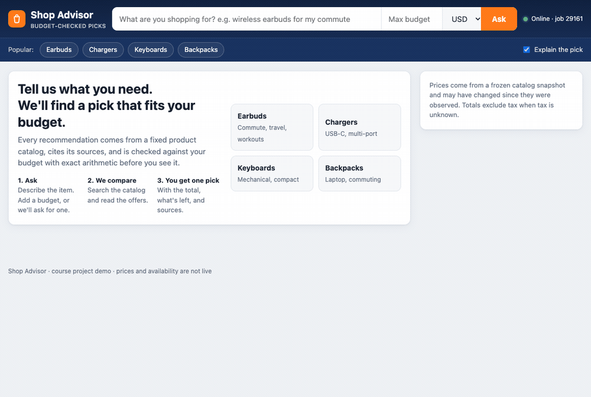

<h1 align="center"> TACC AgentForge</h1>

<p align="center"><strong>A TACC-hosted shopping agent that uses a quantized 27B model to recommend products with source links and budget-checked totals.</strong></p>

<p align="center">
  <a href="#getting-started-instructions">Getting Started</a> ·
  <a href="#detailed-instructions">Detailed Instructions</a> ·
  <a href="#main-results">Main Results</a> ·
  <a href="#known-limitations-and-expected-variation">Limitations</a>
</p>

TACC AgentForge is the course project for **Advanced AI Computing and Systems (CSIT6000V)**. A user describes what they need and how much they can spend. The agent searches a source-linked product catalog, compares offers, checks the plan against the budget with exact decimal arithmetic, and explains its recommendation with citations. The model, **Qwen3.8-27B AWQ INT4**, is served by vLLM on two GPUs on the TACC cluster.

<p align="center">
  
</p>

*Recorded on TACC with the real model: the agent recommends earbuds at **$22.99 before tax** and shows the **$77.01** left in the budget. Idle waits are shortened.*


In the evaluated deployment, the browser talks to a local Python backend (`app/`), which reaches TACC over SSH. One two-GPU TACC job runs vLLM and the agent harness (`agent/`) side by side. The agent queries a pinned SQLite/FTS5 catalog snapshot (`knowledge/`) and only returns plans approved by the budget validator (`agent/budget.py`).

## What this artifact contains

| Directory | Contents |
|---|---|
| `agent/` | LangGraph agent loop, tools, exact budget validator, checkpoints ([internals](agent/ARCHITECTURE.md)) |
| `app/` | Browser page, local backend, harness HTTP service, offline demo and self-test |
| `knowledge/` | SerpApi collection, SQLite/FTS5 snapshots, retrieval tools ([guide](knowledge/README.md)) |
| `assets/knowledge/pilot-snapshot.zip` | The frozen catalog snapshot used by every evaluation (`snapshot_5bcd00723fb0b7589cbe50c8`) |
| `evaluations/` | 42 test cases, independent ground-truth enumerator, scorer, baseline runner, freeze manifest, **raw results** |
| `inference/` | Model client, serving-experiment runner and report generator, **raw serving results** |
| `deploy/tacc/` | TACC job definitions: vLLM service with hourly handover, evaluation job, serving experiments |
| `training/`, `quantization/` | LoRA SFT pilot on the INT4 checkpoint; quantization scripts |
| `scripts/reproduce_results.py` | One command that recomputes the reported numbers from the committed raw data |
| `docs/experiments/` | Experiment reports (baseline, serving, LoRA feasibility, data collection) |
| `tests/`, `agent/tests/` | 600+ automated tests that run offline |

No model weights or credentials are in the repository. The model checkpoint is the course-provided one on TACC.

## Main Results

| ID | Claim | Evidence in this repo |
|---|---|---|
| **C1** | On 32 held-out cases × 3 repeats, the full agent (B3v: multi-step tools + budget validator) succeeds in **42/96** attempts; single-call baselines B0/B1/B2 reach 54/96, 57/96, 57/96. | [baseline report §4](docs/experiments/baseline.md), `evaluations/results/frozen-heldout/report.json` |
| **C2** | The budget validator helps: B3 → B3v paired difference **+0.10 (95% CI +0.02 to +0.20)**. No configuration ever delivered an over-budget plan (BVR 0 in all five). | baseline report §4 |
| **C3** | The multi-step agent is better on cases that need searching (plan cases: B3v 33/60 vs. at most 21/60 for single calls), but loses overall because **48/96 runs hit the 8-call model limit**, including 22/24 runs on cases with no feasible plan (issue #21). | baseline report §4 and §6–7 |
| **C4** | Serving: CUDA graphs give **+202% output throughput** (67.4 → 203.9 tok/s at concurrency 8) over eager mode; prefix caching cuts TTFT p50 by 71% on shared-prefix prompts; FlashInfer attention and FP8 KV cache fail on this setup. | [inference/RESULTS.md](inference/RESULTS.md), `inference/results/` |

The project report's agent-evaluation tables correspond to C1–C3, and its serving tables to C4.

---

# Getting Started Instructions

Expected time: about **10 minutes**, no GPU and no TACC account needed. This part shows that the artifact installs, its tests pass, and the full request path (page → backend → harness → knowledge base → budget validator) works end to end with a scripted stand-in for the model.

## Prerequisites

- macOS or Linux (Windows works; set `PYTHONUTF8=1`, see issue #5)
- Python **3.12** (3.10+ for the core; the agent pins dependencies for 3.12)
- [`uv`](https://docs.astral.sh/uv/) (recommended) or `pip`
- `git`, `unzip`, `curl`
- About 300 MB of disk

Only for the optional real-model run and for rerunning experiments: a CSIT6000V TACC account with the `tcloud` SDK configured ([setup](deploy/tacc/README.md)).

## Setup

```bash
git clone https://github.com/atlasmarkz/tacc-agentforge.git
cd tacc-agentforge
uv venv --python 3.12 .venv
uv pip install --python .venv/bin/python -r agent/requirements.lock pytest
# without uv: python3.12 -m venv .venv && .venv/bin/pip install -r agent/requirements.lock pytest

# Install the pinned catalog snapshot (written to ../tacc-agentforge-data/, next to the clone)
.venv/bin/python -m knowledge bootstrap
.venv/bin/python -m knowledge doctor
```

**Expected:** `doctor` prints a JSON report that starts with `"ready": true` and ends with
`"valid": true, "snapshot_id": "snapshot_5bcd00723fb0b7589cbe50c8", "errors": []`.

## Example 1: automated tests (about 1.5 minutes)

```bash
.venv/bin/python -m pytest tests agent/tests -q
```

**Expected:** `603 passed, 8 skipped` (the skips are optional integrations, such as a live SerpApi key).

## Example 2: end-to-end request without a GPU (about 1 minute)

First, the scripted self-test. It starts the harness service over real HTTP and checks budget clarification, resume, verified plan, streamed explanation, revision, source lookup and token checks:

```bash
.venv/bin/python -m app.harness_service --selftest
```

**Expected:** a JSON block with every check `true`, then `SELFTEST OK`.

Next, the same path that the browser uses. Start the demo harness (scripted model, real catalog snapshot, real budget validator) and the backend in two terminals:

```bash
.venv/bin/python -m app.harness_service --demo --port 8101 --token demo
.venv/bin/python -m app.backend --harness-url http://127.0.0.1:8101 --token demo
```

Open http://127.0.0.1:8765 and ask: *wireless earbuds for commuting, under 100 USD*. Or send the request from a third terminal:

```bash
curl -sN http://127.0.0.1:8765/api/ask -H 'Content-Type: application/json' -d '{
  "session_id": "s1234567890abcdef",
  "message": "wireless earbuds for commuting, under 100 USD",
  "constraints": {"currency": "USD", "purchase_cap": "100", "budget_basis": "pre_tax"}}'
```

**Expected:** a stream of server-sent events (`run_started`, `tool_started`/`tool_finished`, `propose_plan`, `validation_finished`, `explain_delta`, …) ending in `run_completed` with

```text
"status": "completed" ... "verified_plan": {"snapshot_id": "snapshot_5bcd00723fb0b7589cbe50c8",
  "items": [{"offer_id": "offer_640a303bc366430cfd53139e", "quantity": 1, ...}],
  "currency": "USD", "total_cost": "16.87", "remaining_funds": "83.13",
  "cost_breakdown": {"items": "9.88", "shipping": "6.99"}}
```

Leave out `purchase_cap` and the run instead stops with `"status": "waiting_user"` and a question asking for the budget. In the page, answering it resumes the run.

## Example 3 (optional): the real model on TACC

With `tcloud` configured, start vLLM and the harness in one two-GPU job, then point the local backend at it over SSH:

```bash
bash deploy/tacc/service/qwen-service/stage.sh serve --harness
(cd deploy/tacc/service/qwen-service && tcloud submit)
# 5–8.5 minutes later, once the job has published harness-url.txt on the cluster:
.venv/bin/python -m app.backend          # then open http://127.0.0.1:8765
```

SSH settings and stopping the service: [app/README.md](app/README.md) and the [service runbook](deploy/tacc/service/RUNBOOK.md) §2 and §6. A request with a budget takes about 20–40 s with the real model.

---

# Detailed Instructions

The evaluation can be checked at two levels:

1. **Recompute every reported number from the committed raw records** (under 1 minute, no GPU). This independently rescores each recorded model output against the frozen snapshot.
2. **Rerun the experiments on TACC** to produce new raw records (needs a TACC account and GPU time).

## Test cases, data and configurations

| Item | Location |
|---|---|
| Test cases | `evaluations/cases.jsonl`: 42 cases (10 dev, 32 held-out), 4 categories (earbuds, chargers, keyboards, backpacks), English and Chinese. Per split: plan expected / no feasible plan / must ask for budget = 6/2/2 (dev), 20/8/4 (held-out). |
| Ground truth | Computed, not hand-written: `evaluations/catalog.py` reads the snapshot's SQLite file directly, independently of the agent's tools and validator. |
| Catalog data | `assets/knowledge/pilot-snapshot.zip`, snapshot `snapshot_5bcd00723fb0b7589cbe50c8` (251 offers). |
| Configurations | B0: one model call with the top 10 in-budget candidates. B1/B2: B0 plus top-5 keyword/filtered evidence. B3: multi-step agent with real tools, validator replaced by a recorder (ablation). **B3v: full system** (B3 plus the real budget validator). All use temperature 0, thinking off and JSON output. |
| Agent settings | `configs/agent.yaml`, profile `tacc-fast` (8 model calls, 36,000-character context, 512 output tokens) |
| vLLM settings | `deploy/tacc/service/qwen-service/service.json` (TP=2, max length 16384, prefix caching, CUDA graphs) |
| Serving experiment matrix | `configs/experiments.json`, groups `serving27b` (eager baseline) and `graphs` (CUDA graphs) |
| Freeze manifest | `evaluations/freeze.json`: SHA-256 of every evaluated file plus resolved settings (digest `03b0cdea`) |
| Metrics | TSR (task success rate), BVR (budget violation rate), constraint violations, unverifiable claims, made-up IDs; per-case bootstrap 95% CIs. Definitions: [docs/evaluation-metrics.md](docs/evaluation-metrics.md), scoring rules: [evaluations/README.md](evaluations/README.md) §5. |

## Step 1: recompute the reported results (under 1 minute)

```bash
.venv/bin/python scripts/reproduce_results.py
```

The script extracts the frozen snapshot and rescores all 480 held-out and 180 dev attempts in `evaluations/results/frozen-{heldout,dev}/records.jsonl`. It also regenerates the serving report from `inference/results/`. Each part is compared with the committed copy.

**Expected output** (held-out part; supports C1–C2):

```text
== frozen-heldout: 32 cases x 3 repeats (480 attempts)
config      TSR  per-case mean (95% CI)      BVR  plans
B0        54/96  0.56 (0.38-0.72)           0/25  25
B1        57/96  0.59 (0.44-0.75)           0/27  27
B2        57/96  0.59 (0.44-0.75)           0/26  26
B3        32/96  0.33 (0.19-0.50)           0/42  42
B3v       42/96  0.44 (0.28-0.60)           0/36  36
  paired B0 -> B1: +0.03 (95% CI +0.00 to +0.09)
  paired B1 -> B2: +0.00 (95% CI +0.00 to +0.00)
  paired B2 -> B3: -0.26 (95% CI -0.47 to -0.05)
  paired B3 -> B3v: +0.10 (95% CI +0.02 to +0.20)
MATCH: frozen-heldout vs evaluations/results/frozen-heldout/report.json
...
MATCH: frozen-dev vs evaluations/results/frozen-dev/report.json
...
MATCH: .../inference-RESULTS.md vs inference/RESULTS.md
ALL MATCH
```

The full breakdowns for C3 (by expected outcome, by category, failure reasons, model calls, latency) are in the rescored `report.json` the script writes, under `summary.<config>`. They are also explained in [docs/experiments/baseline.md](docs/experiments/baseline.md) §4–7. Complete model inputs and outputs for the failure traces are in `evaluations/results/frozen-trace-dev/traces.jsonl`.

To rescore a single results folder by hand:

```bash
unzip -oq assets/knowledge/pilot-snapshot.zip -d /tmp/agentforge-snapshot
.venv/bin/python -m evaluations.run --rescore <folder with records.jsonl> \
  --snapshot-db /tmp/agentforge-snapshot/snapshot_5bcd00723fb0b7589cbe50c8/catalog.sqlite
```

## Step 2: rerun the agent evaluation on TACC (C1–C3)

**Resources.** One 2-GPU node for the model service plus one CPU job for the runner (both of the account's job slots). The held-out run is 480 attempts with about 1.4 hours of pure model time. With the 1-hour job limit, service handovers and queueing, it took about 2.5 hours of wall time across several jobs (services 28999/29011/29016, runner jobs 29006/29014/29015/29017).

**Use the frozen commit.** The runner refuses the held-out split unless the files match `evaluations/freeze.json`. Later commits on `main` changed the agent, so check out the frozen system first:

```bash
git checkout cc6059d
.venv/bin/python -m evaluations.freeze check      # expected: "matches the freeze"
```

1. **Start the model service with handover** so that it outlives the 1-hour job limit ([runbook](deploy/tacc/service/RUNBOOK.md) §2):
   ```bash
   # on the cluster: allow up to 3 successor jobs
   echo '{"remaining": 3}' > $TACC_USERDIR/tacc-agentforge-service/service-chain.json
   # locally: hand over 15 minutes before the time limit, then submit
   echo '--handover-lead-s 900' > deploy/tacc/service/qwen-service/args.txt
   bash deploy/tacc/service/qwen-service/stage.sh serve
   (cd deploy/tacc/service/qwen-service && tcloud submit)
   ```
2. **Stage and submit the evaluation runner** (it waits for `service-url.txt` before it starts):
   ```bash
   cd deploy/tacc/service/agent-e2e
   echo eval_baseline.py > script.txt
   echo '--split heldout --unseal-heldout --configs B0,B1,B2,B3,B3v --repeats 3 --out heldout-rerun --resume' > args.txt
   bash stage.sh && tcloud submit
   ```
3. **When a runner job reaches its time limit, submit it again with the same arguments.** `--resume` skips recorded attempts. Attempts lost to service gaps are retried automatically and logged to `infra.jsonl`; they are not counted as system failures.
4. **Score:** the runner writes `records.jsonl`, `scores.jsonl` and `report.json` in its output folder. Compare `report.json` → `summary` with the table in Step 1, or rescore it with the command above.

For the dev split, use `--split dev` (no unsealing needed). Clear `args.txt` in `qwen-service/` afterwards so the next service run does not inherit it. Details: [evaluations/README.md](evaluations/README.md) §7–8.

## Step 3: rerun the serving experiments on TACC (C4)

```bash
cd deploy/tacc/vllm-experiments
bash stage.sh serving27b 2 && tcloud submit      # eager baseline + one-flag variants
bash stage.sh graphs 2 && tcloud submit          # CUDA-graph baseline + variants
# copy each job's result folder into inference/results/, then:
.venv/bin/python -m inference.report inference/results/serving27b-* inference/results/graphs-* --out inference/RESULTS.md
```

Each variant restarts vLLM (about 3.5–9 minutes to start), so one group needs most of a 1-hour job. If a job ends early, rerun the missing variants with `stage.sh <group> 2 <variant> ...`. The workload is 8 prompts × 2 repeats per stage at concurrency 1/4/8, plus `vllm bench serve` (512 input / 128 output tokens, 32 prompts). See the setup section of [inference/RESULTS.md](inference/RESULTS.md).

## Known limitations and expected variation

- **Agent results on a rerun will not be identical.** All configurations use temperature 0, but vLLM batching and prefix-cache state are not bit-deterministic, so individual multi-step (B3/B3v) attempts can change. Expect the held-out TSRs to stay within the reported per-case 95% intervals. For example, B3v 42/96 has a per-case interval of 0.28–0.60.
- **Step 1 is exact.** Rescoring is deterministic (the bootstrap is seeded), so it must print `ALL MATCH`.
- **Latency and throughput depend on the node.** GPU model and co-located jobs vary across TACC nodes (logs suggest RTX 3090-class, about 23.7 GiB). Compare relative changes within one job, not absolute numbers across jobs. The serving report marks changes under 3% as "~same".
- **The model-call limit dominates agent failures** (C3, issue #21): the agent does not know its remaining budget, and paginated searches that include unknown-price items keep it searching. This is measured as part of the baseline, not fixed in the frozen system.
- **Correctness is relative to the frozen snapshot**, not to the real world. All 251 offers have unknown tax, so budgets are compared pre-tax. Known data errors in the snapshot are inherited by the ground truth ([evaluations/README.md](evaluations/README.md) §4).
- **The validator checks money, not requirements.** Three B3v plans were approved even though a required attribute was unknown (baseline report §6).
- **Not evaluated:** the planned fifth, held-out category (needs new data collection after the freeze), human ratings of explanation quality, and retrieval Recall@5/MRR@5 (the 602-row relevance pool in `evaluations/relevance_pool.jsonl` is unlabeled).
- **TACC availability.** The service needs a free 2-GPU node, and a queued successor job leaves a gap of minutes or more. The runner waits and retries rather than failing.
- **Documentation language.** Several sub-guides (`evaluations/README.md`, `docs/experiments/baseline.md`, the runbook) are written in Chinese. This README contains everything needed to run and reproduce the results.

## Further reading

- [Baseline evaluation report](docs/experiments/baseline.md) · [Metric definitions](docs/evaluation-metrics.md) · [Evaluation guide](evaluations/README.md)
- [Serving experiment results](inference/RESULTS.md) · [Model service runbook](deploy/tacc/service/RUNBOOK.md)
- [Agent internals](agent/ARCHITECTURE.md) · [Knowledge base](knowledge/README.md) · [Application](app/README.md)
- [LoRA feasibility on the INT4 model](docs/experiments/2026-10-28-27b-lora-feasibility/README.md) · [SerpApi data collection](docs/experiments/2026-10-28-serpapi-collection/README.md)
- [Project proposal](output/pdf/shopping-budget-advisor-proposal.pdf) · [Development plan](tasks/plan.md)
- A public cloud deployment (agent on a free VM, model on TACC) lives on the [`feat/cloud-agent-service`](https://github.com/atlasmarkz/tacc-agentforge/tree/feat/cloud-agent-service) branch. It is not part of the evaluated system.

## License

No license has been selected. All rights are reserved by the repository owner.
