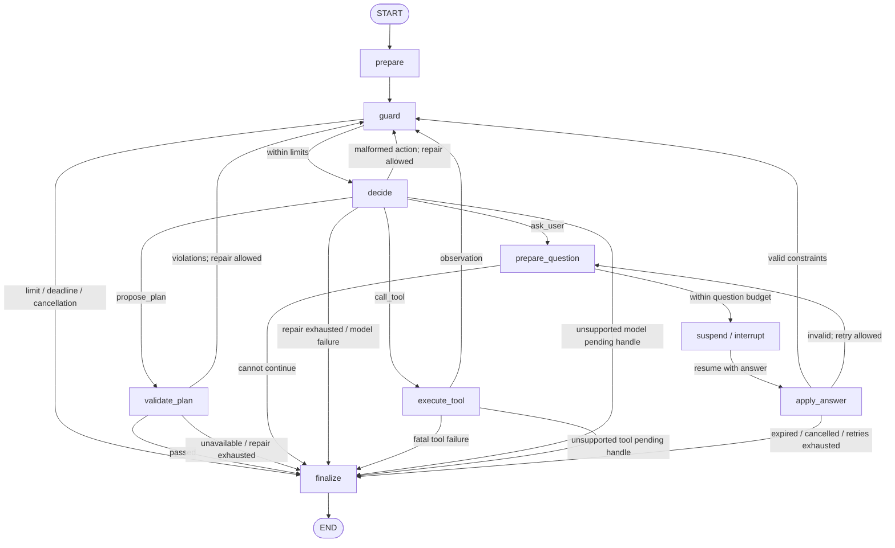

# Agent loop architecture

Status: runnable nine-node framework with checkpointed user-question resume;
real integrations and production storage/deployment remain future milestones.
Updated: 2026-11-10.

## Implementation status

The offline path now executes through `runtime.py`, `graph.py`, `nodes.py`, the
typed contracts and injected capabilities. Run `python -m agent.examples.mock_run`
after installing the agent dependencies; see [README.md](README.md) for commands.

Implemented: `run` / executing `astream`, the three actions, an immutable tool
registry, strict argument/result checks, bounded repair loops, deadlines and
cooperative cancellation, validation receipts, structured events, user-question
checkpoints, `resume` / `astream_resume`, and scenario tests. The example uses
explicit synthetic model/search/validator adapters; `--clarify` exercises resume.

The design below also records future contracts. In this milestone:

- The runtime's `CallContext` and cancellation scope supply execution context;
  there is no separately configurable ExecutionContext port. Checkpoint state
  uses version 2; the default saver is in-memory and can be externally replaced.
- Context is bounded by characters/history length and tool-result bytes. Real
  token accounting must be supplied by the model adapter.
- ToolSpec implements identity, schemas, executor, timeout and result limits;
  side-effect/idempotency metadata is deferred until real tool integration.
- User questions use `interrupt` and `Command(resume=...)`. Model/tool pending
  handles remain unsupported. Production database provisioning and distributed
  locking are outside the runtime; see README for the single-owner constraint.
- Dependency files and a universal development lock are confined to `agent/`;
  project-wide manifest changes and default test discovery remain outside scope.

## 1. Scope and decision

Build an embeddable Python library inside `agent/`. The library accepts a request
and injected capabilities, runs a bounded decision/tool loop, and returns a
structured outcome plus execution events. It does not start a server or manage
infrastructure.

Use LangGraph `StateGraph` as the execution engine. Use ReAct as the model's
decision → action → observation pattern inside that graph. Do not depend on
LangChain's high-level agent factory. LangGraph may bring `langchain-core` as a
transitive dependency; this decision does not promise a dependency-free runtime.

Use Pydantic 2 for boundary validation, `TypedDict` for graph state, and Python
`Protocol` for capability ports. Agent requirements and the development lock are
stored alongside the package and preserve the project's Python 3.10+ constraint.
The repository-wide project manifest has not been changed.

Start with a single agent and serial tool execution. Keep deterministic checks
as code. A proposal from the model cannot bypass the plan-validation gate.

## 2. Ownership boundaries

| Agent package owns | Supplied by other modules / embedding application |
| --- | --- |
| Graph topology, nodes, conditional routing | Model inference and service deployment |
| Typed requests, actions, observations and outcomes | Provider-specific request/response formats |
| Tool registry and argument validation | Evidence retrieval and SerpApi acquisition |
| Step/call limits, deadline propagation, cancellation checks | SDK file transfer and job lifecycle |
| Mandatory plan-validator invocation | Exact budget and requirement-validation algorithms |
| Pause/resume contract and event emission | Database provisioning, queues, authentication and UI |
| State schema and checkpoint integration point | Persistent checkpointer construction and retention |

The earlier TACC constraint remains valid: transport may use only SDK file
transfer. The loop does not select its deployment location or implement that
transport. A host-side adapter can expose file-mediated inference through the
same model port used by a TACC-local HTTP adapter. No direct public TACC model
endpoint is assumed.

The existing `inference/client.py` is an integration target, but its `chat`
method is currently unimplemented. A fake model in the example/test harness
allows the loop to be developed without waiting for that module.

## 3. Package layout

```text
agent/
  __init__.py          Public exports
  contracts.py         Requests, actions, results, errors and capability protocols
  state.py             Serializable AgentState and initial-state construction
  runtime.py           AgentRuntime facade; run / resume / event streaming
  graph.py             Graph construction, edges and dependency injection
  nodes.py             Prepare, guard, decide, execute, validate, finalize, suspend
  answers.py           Structured answer field/value/size boundary checks
  tools.py             ToolSpec, registry, dispatcher and observations
  policies.py          Immutable limits and execution-context checks
  prompts.py           Decision prompt and bounded context construction
  examples/
    mock_run.py        Explicit fake model/tools; no credentials or network
  tests/
    test_runtime.py    Scenario tests for graph behavior
  README.md
  ARCHITECTURE.md
```

These Python files are implemented for the first milestone. Keep nodes in one
file initially. Split adapters, context strategies and tool
implementations only when concrete integrations need them.

## 4. Public contracts

The facade exposes initial and resumed execution, with concrete types in
`contracts.py`. Default checkpoints live in the Runtime's `InMemorySaver`.
Injected savers must implement the async BaseCheckpointSaver API.

```python
AgentRuntime(dependencies, policy, checkpointer=None)
await runtime.run(request: AgentRequest) -> AgentResult
await runtime.resume(run_id, question_id, answer: dict) -> AgentResult
runtime.astream(request: AgentRequest) -> AsyncIterator[AgentEvent]
runtime.astream_resume(run_id, question_id, answer: dict) -> AsyncIterator[AgentEvent]
```

`astream` executes a run and emits its events; it does not attach to or replay
an independently started run. Subscription, event persistence and SSE belong to
the embedding application. Model-token streaming is a separate model capability
and is not implied by this interface.

`AgentRequest` contains a run ID, conversation ID, user message, snapshot ID and
structured constraints. Run IDs and model/tool operation IDs are generated or
validated by trusted runtime/application code, never selected by model output.

The graph receives capability implementations through `AgentDependencies`:

| Port | Contract and purpose |
| --- | --- |
| `ModelPort` | Produce a model reply, pending-operation handle, or typed failure; accept bounded messages, action schema, timeout and operation ID |
| `ToolRegistry` | Resolve an allowlisted ToolSpec and execute schema-validated arguments; return an observation, pending operation, or typed failure |
| `PlanValidator` | Check a proposed plan against authoritative snapshot facts and business rules; return passed/failed/unavailable, violations, and verified result data |
| `EventSink` | Receive typed progress/usage events; operational telemetry is separate from mandatory audit persistence |
| `ExecutionContext` | Provide trusted run identity, cancellation signal, clock and remaining execution budget |

All external calls use operation IDs and propagated timeouts. Adapters own
network/SDK details and must document cancellation and idempotency behavior.
Making a Python function asynchronous does not itself make underlying I/O
cancelable or durable.

The model/tool ports currently support immediate replies only. Their pending
responses yield an explicit unsupported-capability outcome; the supported resume
path is for user questions. Do not silently poll or block indefinitely.

## 5. Model action protocol

Validate model output as a tagged union, with three initial actions:

```text
call_tool:    {type, tool_name, arguments}
propose_plan: {type, plan}
ask_user:     {type, question, required_fields}
```

There is no direct model action that marks a shopping recommendation successful.
Only the runtime can do that after plan validation. Proposed product/offer IDs,
quantities and evidence references are checked against authoritative data.
Model-generated prices or totals are not authoritative.

The model adapter can normalize either native function calls or schema-constrained
JSON into this protocol. Initially allow one action per decision. Malformed or
unknown actions produce a bounded repair observation; do not use regex or `eval`
to execute model text. Model action validity is separate from tool argument and
business-rule validity.

## 6. Graph topology



The Runtime validates inputs and creates initial state; `prepare` emits the start
event. `guard` checks budgets before each decision. The dispatcher also checks before every external tool call;
validation and finalization perform their own deadline/cancellation checks.

`decide` constructs bounded context, invokes the model and validates the action.
`execute_tool` validates allowlist membership and arguments, performs one call,
and normalizes its result. Recoverable failures become explicit observations;
fatal failures end the run with a reason.

`validate_plan` is mandatory. Missing validation capability or unavailable cost
evidence cannot produce `completed`. `finalize` returns the validator's verified
data and a structured outcome. Any later LLM-written explanation must not mutate
verified amounts, selections or citations without revalidation.

`prepare_question` saves a stable ID, the requested fields and wall-clock expiry
before entering `suspend`. `suspend` only calls interrupt, then returns the answer
after resume. The Runtime returns waiting_user without executing finalize/END.
`apply_answer` validates and merges only the requested top-level constraint fields,
clears obsolete verified plans, records the answer and returns to guard. Invalid
answers re-enter prepare_question with a fresh ID within bounded retries.

The checkpoint thread key is `agent:<run_id>`. The Runtime rejects wrong question
IDs, duplicate new-run IDs and non-waiting resumes before graph execution. The
same Runtime also rejects overlapping invocations; hosts sharing checkpoints
across processes/Runtime instances must serialize access themselves.

## 7. State and dependencies

Persist only serializable, bounded data in `AgentState`:

```text
state_version, request, policy
history, usage, consecutive_action_errors, rejected_plans
action, verified_plan, clarification, issues, status, stop_reason, next_node, result
pending_question, resume_answer, question_count, answer_errors
active_elapsed_s, event_sequence
```

Do not put clients, registries, database connections, credentials, cancellation
objects or raw exception objects into graph state. Inject those as runtime
dependencies. Keep full evidence archives in the knowledge module; store IDs
and bounded excerpts in state.

Use a monotonic clock for each active segment and save cumulative active time
with node checkpoints. Waiting results report the saved active time. Question
expiry is a separate UTC epoch timestamp and is checked when an answer resumes
the run. Waiting time does not consume execution time. Resume loads the original
policy and counters; new Runtime defaults cannot silently reset those limits.

Checkpoints can include messages and user constraints, so persistent adapters
need the application's access controls and retention policy. Telemetry should
record node/action IDs, timings and usage rather than raw hidden reasoning.

## 8. Outcomes, events and limits

Terminal outcomes: `completed`, `incomplete`, `failed`, `cancelled`.
Suspended outcome: `waiting_user`. External-operation waiting is deferred.

Examples of stop reasons: `step_limit`, `model_call_limit`, `tool_call_limit`,
`token_limit`, `deadline_exceeded`, `invalid_action`, `validation_unavailable`,
`insufficient_evidence`, `external_failure`, `unsupported_capability`.

`waiting_*` means suspended, not a successfully completed recommendation.
In-memory waiting state is process-local and must not be described as durable.

Initial configurable policy defaults for a mock/local framework run:

| Limit | Initial value |
| --- | --- |
| Model decisions | 8 |
| Tool calls | 8 |
| Consecutive malformed-action repairs | 2 |
| Plan-validation repairs | 2 |
| Whole-run deadline | 120 seconds |
| Questions per run | 8 |
| Invalid-answer repairs | 2 |
| Question wait expiry | 1800 wall-clock seconds |
| Answer JSON size | 8192 UTF-8 bytes |

These are starting configuration values, not measured production settings.
Context/output token budgets must be supplied by the model adapter according to
its actual context limit; the current reference deployment uses 4096 tokens.
Validate policy values, count repairs and attempts, and retain counts on resume.
LangGraph's recursion limit is an additional safety bound, not the definition of
business-level model/tool limits.

Suggested events: `run_started`, `decision_started`, `action_selected`,
`tool_started`, `tool_finished`, `validation_finished`, `run_waiting`,
`run_completed`, `run_stopped`. Include run/operation IDs, sequence or event ID,
timing and typed status. Never expose secrets or treat tool evidence as trusted
instructions.

## 9. Incremental delivery

### First runnable framework

- Implement contracts, dependency injection, graph and bounded serial loop.
- Implement the three action types, tool registry and argument validation.
- Require an injected plan validator for successful recommendations.
- Return explicit incomplete/error outcomes when integrations are absent.
- Add structured events and an executable fake-model/fake-tool example.
- Support `run` and executing `astream`. The subsequent question milestone adds
  checkpointed resume, bounded answer validation and the two question nodes.
- Prove success, clarification, unknown tool, invalid arguments, malformed output,
  model/tool failure, failed validation, deadline and step-limit behavior with
  scenario tests under `agent/tests/`.

Fixtures and fake adapters stay in examples/tests and must not be silently used
as runtime defaults. Tests under `agent/tests/` require explicit invocation or
later coordination with the repository's current `testpaths = ["tests"]`.

### Integrate real project capabilities

- Connect the model adapter to the inference owner's client.
- Register retrieval/acquisition tools from the knowledge owner.
- Inject exact budget and requirement validation from its owner.
- Add bounded context selection, citations and the project's held-out scenarios.
- Validate actual checkpoint support for structured actions; do not infer tool
  support from the successful arithmetic smoke test.

### Add production durability

- Deploy and validate a durable injected checkpointer; memory-backed user resume
  and the async checkpointer integration point are already implemented.
- Add pending operations, correlation checks, replay-safe operation records and
  idempotency coordination with external adapters.
- Add state/graph-version compatibility, retention and recovery tests.
- Integrate event persistence and operational telemetry through the host.
- Fault-test interruption before/after external calls and checkpoints. Checkpoint
  persistence alone does not guarantee exactly-once tool side effects.

Infrastructure remains outside `agent/` throughout these milestones.

## 10. Concrete request and result envelopes

The following JSON is a synthetic interface example, not collected product data.
The application supplies the trusted IDs. The runtime rejects extra top-level
fields, missing required values and incompatible schema versions before invoking
the graph.

```json
{
  "schema_version": "1",
  "run_id": "demo-run-001",
  "conversation_id": "demo-conversation-001",
  "snapshot_id": "demo-snapshot-v1",
  "message": "Find wireless earbuds for commuting.",
  "constraints": {
    "currency": "USD",
    "purchase_cap": "100.00",
    "requirements": ["wireless", "suitable for commuting"]
  }
}
```

This constraints shape is illustrative; agree its domain schema with the budget
and knowledge owners. Preserve missing observations rather than assuming zero
fees or complete account balances. Decimal amounts cross JSON boundaries as
canonical strings. Validate identifiers, text length, quantities and constraint
values before passing them to tools.

The AgentResult envelope has stable fields:

| Field | Meaning |
| --- | --- |
| `schema_version`, `run_id`, `conversation_id`, `snapshot_id` | Contract version and correlation |
| `status` | completed / incomplete / failed / cancelled / waiting_user |
| `stop_reason` | Machine-readable reason; absent on normal completion |
| `verified_plan` | Authoritative validator output; absent unless validation passed for the current proposal and constraints |
| `clarification` | Question and required fields when waiting for the user |
| `issues` | Bounded, sanitized errors or validation violations |
| `usage` | Decision/model/tool counts, available token usage and elapsed time |
| `pending_question` | question_id, question, required_fields, expires_at; present only while waiting_user |

Never return `verified_plan` from an older successful validation after changing
the proposal, constraints or snapshot. Validation receipts must identify the
proposal fingerprint, constraint version and snapshot they validate.

`ask_user` now returns a checkpointed waiting_user outcome. The caller submits
run_id, the current question_id and a structured constraint answer to resume.
The default memory saver supports continuity only while its process/object lives.
Injected storage lifecycle, retention and production acceptance belong to the host.

## 11. Capability method contracts

These are interface sketches; they are not Python implementations:

```python
class ModelPort(Protocol):
    async def generate(
        self, request: ModelRequest, context: CallContext
    ) -> ModelOutcome: ...

class ToolExecutor(Protocol):
    async def execute(
        self, arguments: ValidatedArguments, context: CallContext
    ) -> ToolOutcome: ...

class PlanValidator(Protocol):
    async def validate(
        self, request: PlanValidationRequest, context: CallContext
    ) -> ValidationResult: ...
```

`CallContext` contains the runtime-issued operation ID, run/snapshot identity,
remaining time and cancellation signal. It is injected, never accepted from
model-generated tool arguments. Use a fresh operation ID for a new intended
operation; retain the same logical ID across retries/resumption of that operation.
Record an attempt number separately.

`ModelRequest` contains provider-neutral messages, allowed action schemas and
input/output limits. `ModelOutcome` carries a reply and usage, a pending handle,
or a typed provider failure. The adapter maps native function calls or parsed
JSON to the same action union. An incomplete/truncated model response is not a
valid action merely because a fragment could be parsed.

`ToolOutcome` carries JSON-serializable data and provenance references, a pending
handle, or a typed tool failure. Each tool has a ToolSpec:

| ToolSpec field | Purpose |
| --- | --- |
| `name`, `version`, `description` | Stable identity and model-facing description |
| `arguments_model` | Pydantic argument schema and runtime validation |
| `result_model` | Validation of returned data before context insertion |
| `executor` | Injected implementation |
| `timeout_s` | Maximum call duration, also bounded by remaining run time |
| `max_result_bytes` | Bound tool observations; truncation must be explicit |
| `effect_kind` | read_only / acquisition / other; acquisition is budgeted even when it retrieves data |
| `idempotency_support` | Declared adapter behavior, not a guarantee supplied by the graph |

Reject duplicate registrations. A lookup of an unregistered name cannot import
modules or discover functions dynamically. Reject unknown argument fields and
invalid result shapes. Descriptions and schemas are included in model context;
executor objects and credentials are not.

The first milestone does not automatically retry external I/O. A retry policy
can be added after each adapter's side effects and idempotency are understood.
Returning a recoverable observation to the model is distinct from automatically
reissuing a network call. Acquisition adapters must enforce their own durable
API-call budget when integrated.

`PlanValidationRequest` includes the proposed plan, constraints and snapshot ID.
`ValidationResult` is one of:

- `passed`: authoritative selections, quantities, amounts, citations and a receipt
  tying those facts to the input version;
- `failed`: machine-readable violations that a new proposal may address;
- `unavailable`: a missing validator, missing essential data, or unavailable
  verification service. No successful recommendation is emitted.

## 12. Node inputs and state updates

Nodes return state updates rather than mutating a shared state dictionary in
place. Use explicit replacement or documented append reducers for collections;
do not accidentally duplicate the message history on every transition.

| Node | Reads | Writes / routes |
| --- | --- | --- |
| `prepare` | validated request and policy | start event; initialization happens in Runtime |
| `guard` | counts, deadline, cancellation | continue / stop reason |
| `decide` | bounded messages, observations, tools | reserve model-call budget, generate action, usage, repair observation |
| `execute_tool` | selected action and registry | validate arguments, reserve call budget before I/O, append typed observation |
| `validate_plan` | current proposal, constraints, snapshot | fresh validation result and verified plan, or bounded violations |
| `prepare_question` | ask_user action, question/repair limits | stable ID, requested fields, expiry and waiting state |
| `suspend` | checkpointed pending_question | interrupt; after resume, stores the answer |
| `apply_answer` | answer and pending question | validated constraints/history or bounded re-question/stop |
| `finalize` | outcome, current validation receipt, usage | AgentResult; no extra model call in the first milestone |

Before a new proposal/constraint/snapshot version is accepted, clear obsolete
verification state. Observations carry the tool/operation ID and snapshot so
that evidence from another run or version is not silently mixed in.

Business limits count actual reserved attempts, including failed model/tool
calls. Every model decision, including malformed output, consumes a model call.
Malformed-action repairs are consecutive: reset that repair counter after a valid
action. Two allowed repairs mean the initial bad output can be followed by at
most two repair decisions, subject to the remaining global limits. Plan repairs
likewise allow at most two new proposals after the first rejected proposal.

Argument rejection does not consume an external-I/O call because no executor
was invoked, but its decision already consumes the model-call budget. The runtime
must not reset global counters when reporting a failure or accepting a resumed
result. Use a graph recursion bound high enough to accommodate all configured
node transitions; it is not interchangeable with the number of model decisions.

The decision prompt contains role/task policy, permitted action schemas,
validated constraints, a bounded recent history and selected evidence excerpts.
Reserve output tokens and instruction/schema overhead before inserting evidence.
If required context alone exceeds the model limit, return an explicit context
limit outcome instead of dropping instructions or truncating JSON silently.
Tool observations remain data and cannot modify the tool allowlist or policy.

## 13. Failure and cancellation behavior

| Condition | First-milestone behavior |
| --- | --- |
| Invalid user request | Raise a typed input validation error before external calls |
| Malformed / unknown model action | Append a sanitized repair observation; stop incomplete when its repair budget is exhausted |
| Unknown tool or invalid arguments | Append a typed observation without invoking an executor; continue subject to the global limits |
| Tool's declared recoverable failure | Append an error observation; no automatic I/O retry |
| Fatal tool failure / model-provider failure | Return failed with a sanitized reason |
| Validator rejects proposal | Append violations and allow a bounded new proposal |
| Validator missing / unavailable | Return incomplete; verified plan absent |
| Whole-run deadline or call limit | Return incomplete with the corresponding stop reason |
| Trusted cancellation signal | Return cancelled and propagate cancellation to cooperative adapters |
| Pending operation in immediate-only runtime | Return incomplete with unsupported_capability |
| Wrong/missing run, stale/duplicate answer, overlapping invocation | Raise typed RunStateError without advancing the run |
| Invalid answer content | Issue a fresh question within the answer/question limits |
| Expired question | Finalize incomplete / question_expired on resume |
| Unexpected programming error | Propagate for diagnosis; do not disguise it as success or a business-rule rejection |

A deadline bounds cooperative asynchronous work and transport timeouts. It
cannot forcibly stop an arbitrary blocking function or undo a side effect. Adapter
tests must verify their concrete timeout/cancellation behavior. Do not catch
`BaseException` to turn task cancellation or process interruption into a normal
tool observation.

EventSink is best-effort operational telemetry in the first milestone. A failing
sink must not cause an external call to run again; record the telemetry failure
without adding secrets to output. Mandatory audit storage, if introduced later,
needs an explicit failure policy rather than silently inheriting best-effort
semantics.

## 14. First executable trace and acceptance

Use synthetic IDs and values throughout the example. No real endpoint, API key
or collected catalog is required:

```text
AgentRequest(demo snapshot and constraints)
  -> prepare -> guard
  -> fake model: call_tool(search_products, query=wireless earbuds)
  -> fake search: demo offer and demo evidence IDs
  -> guard
  -> fake model: propose_plan(offer IDs, quantities, evidence IDs)
  -> fake validator: passed with a verified synthetic cost breakdown
  -> finalize: completed + verified_plan + usage
```

Supply fakes explicitly in the example. A missing real dependency in ordinary
application code must not select a fake implementation automatically.

The first milestone is complete when:

- the example runs locally without network access and without changes to other
  owners' modules;
- graph execution uses the same request/action/tool/result contracts for both
  the example and future adapters;
- scenario tests demonstrate the success trace and each declared failure branch;
- an unknown tool or invalid arguments never invoke the executor;
- a rejected/unavailable validator can never produce completed;
- model-supplied totals cannot replace the validator's verified amounts;
- two simultaneous independent runs do not share messages, counters or evidence;
- every loop exits within configured model/tool/repair limits;
- the event stream identifies the run and preserves per-run event order;
- user-question resume preserves history, snapshot, call counters and original
  policy, without replaying completed tools; external pending handles remain
  explicit unsupported outcomes;
- question identity, duplicate answers, expiry, retries, event sequence and active
  time accounting are covered by agent/tests/test_resume.py.

Implementation order: contracts and state → tool registry and policy → nodes
and graph → runtime facade → mock example and branch-oriented scenario tests.
Avoid adding infrastructure or speculative multi-agent layers to this milestone.

## 15. References

- [LangGraph overview](https://docs.langchain.com/oss/python/langgraph/overview)
- [Graph API: state, nodes and edges](https://docs.langchain.com/oss/python/langgraph/graph-api)
- [Persistence](https://docs.langchain.com/oss/python/langgraph/persistence)
- [Interrupts and replay/idempotency rules](https://docs.langchain.com/oss/python/langgraph/interrupts)
